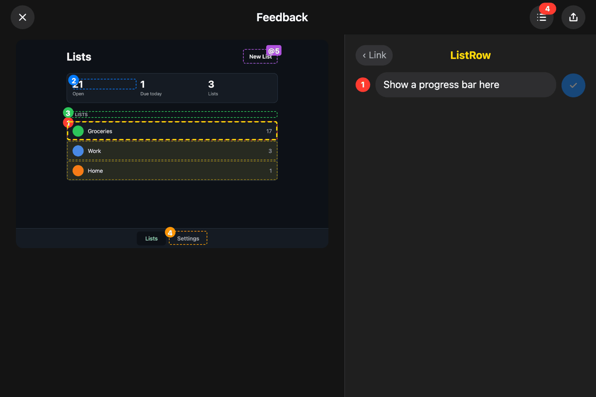
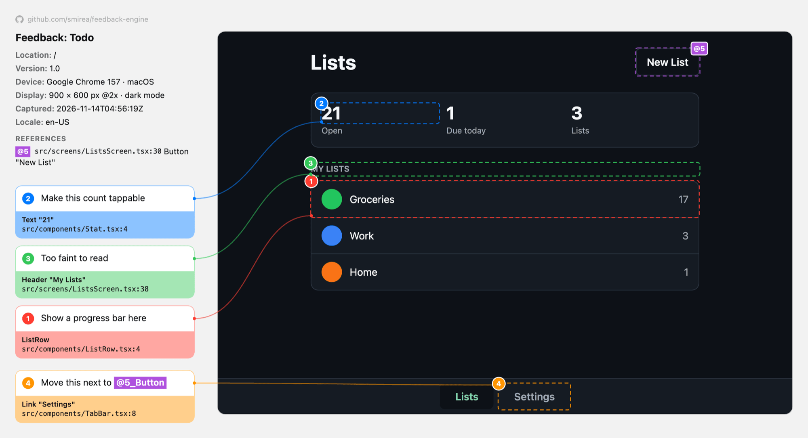

# Feedback

**Point at your app. Say what's wrong. Hand an agent the exact component and line of code.**

Shake the device, Alt+Meta+click anything in the browser, or hold three fingers on a phone's browser, tap any component on the frozen screenshot, and write what should change. Feedback exports one file that names every component you flagged, where it lives in the source, and the data it was showing, so an agent can act on the feedback without guessing.

| Tap a component in the editor | The `feedback.png` it exports |
| :---: | :---: |
|  |  |

Four notes on one screen. The fourth points at a second element. Type `@`, tap the element, and the note reads `Move this next to @5_Button`. The export draws that element's box and highlights the token in the same color, so an agent knows which button you meant.

<p align="center">
  <br>
  <sub>Four notes, one with a reference, then the exported image. Played at 3.5× speed. <a href="docs/demo.mp4">Full quality video</a></sub>
</p>

Prefer structured data? Share JSON for the whole component tree, each component's data, and the app context you attached, or both in one ZIP. A [webhook](#webhooks) adds a Share entry that posts both to a server of yours in one tap, such as one that files a GitHub issue. With the optional [ProcrastiMate](#procrastimate) integration, the Share menu also posts the feedback as a task.

Platform packages live under `packages/`: `Feedback` for iOS and `@stefan.inc/feedback-engine` for the web, with an entry point for Svelte and one for React. All of them produce the same report ([spec/report.md](spec/report.md)). [spec/features.md](spec/features.md) lists every feature with its status on each platform.

The web package is on npm, with a version for every change and a [changelog](packages/web/CHANGELOG.md). The iOS package has no tagged releases: `master` is the release, so pin a commit when a build has to stay put.

## iOS

Requires iOS 17 or later and Swift 6.

### Add the package

In Xcode, add the package from this repository (or a local checkout with **Add Local…**) and link the `Feedback` library to your app target. In a `Package.swift`:

```swift
.package(url: "https://github.com/smirea/feedback-engine", branch: "master"),
```

### Turn it on

```swift
import Feedback

@main
struct MyApp: App {
    @State private var store: Store

    init() {
        let store = Store()
        _store = State(initialValue: store)
        Feedback.enable()
        Feedback.context("Store") { store }
    }
    // ...
}
```

- `Feedback.enable()` turns on shake-to-feedback. A shake morphs an **Add Feedback** glass pill out of the top center of the screen, growing from a Dynamic Island–sized capsule, and tapping it opens the editor. Top center sits between a navigation bar's leading and trailing buttons, so the pill covers at most the bar's title. Left alone, the pill morphs back up after 5 seconds, so an accidental shake costs nothing. Leaving the app or locking the phone clears it at once. Wrap the call in `#if DEBUG` if you only want it in development builds.
- `Feedback.context(name) { value }` attaches app state to every JSON export. The closure runs when a capture is taken.
- `Feedback.present()` opens the editor directly from your own trigger, such as a settings button.

### Name your components

Add one modifier at the end of each view's `body`:

```swift
struct TodoRow: View {
    let item: TodoItem
    @State private var isExpanded = false

    var body: some View {
        HStack { /* ... */ }
            .feedback(self)
    }
}
```

`.feedback(self)` names the component after its type, without generic arguments, so `DashboardCard<ProgressView<…>>` is `DashboardCard`. It reports the view's stored properties and its `@State`, `@Binding`, and `@Bindable` values. Closures, `@Environment` values, and other SwiftUI and Combine internals are skipped at any depth, including inside your own helper structs. To choose the name or the data yourself, use `.feedback("TodoRow", data: item)`.

Data reads like code: optionals show their value or `nil`, floating-point numbers keep 3 decimals (3 significant digits below 1), and nested values are written as `Entry(kg: 72.575, note: nil)`. Nesting stops after 3 levels and collections after 10 elements, and a component's data stops at 1,500 characters. Types with a `CustomStringConvertible` description, such as `Date` and `UUID`, use it.

Your own property wrappers are skipped unless they conform to `FeedbackRepresentable`, which reports `feedbackValue` in the wrapper's place. Conform any other type the same way to choose how it reads:

```swift
extension Observe: FeedbackRepresentable {
    var feedbackValue: Any { wrappedValue }
}
```

Untagged views still appear: buttons, text, images, and headers come from the accessibility tree and attach to the smallest tagged component around them. When two tagged views share a frame, such as a card that wraps another tagged view, they attach to the inner one. A button or `NavigationLink` merges everything inside it into one element, such as `Button "Work, 3"`, so the text and counts inside it can't be picked one by one. A tagged component inside the button still can, and its parent is the button. Tag an inner view when it needs feedback of its own.

### Set up your app's coding agents

[`skills/feedback-accessibility/SKILL.md`](skills/feedback-accessibility/SKILL.md) is the playbook for making screens accessible and precise to point at: built-in accessibility first, Feedback tags only where a tap would otherwise be ambiguous, and a way to check each screen. To have your app's agents follow it, add this to the app's `AGENTS.md` (or `CLAUDE.md`):

```md
- When you build or change a SwiftUI screen, row, card, or chart, follow Feedback's accessibility skill. Read the latest with `gh api repos/smirea/feedback-engine/contents/skills/feedback-accessibility/SKILL.md -H 'Accept: application/vnd.github.raw'`.
```

The command reads the skill from `master`, so the app picks up changes without a copy to update. To make it a project skill that Claude Code loads by name, copy the folder to `.claude/skills/feedback-accessibility/` instead, and refresh the copy when the skill changes.

### Give feedback

1. Shake the device, then tap **Add Feedback** at the top of the screen within 5 seconds. In the simulator, use **Device › Shake**.
2. Tap the screenshot. The most specific component or element under your finger is selected, and the same part in sibling components, such as the same button in every row, is outlined faintly. Scroll the screenshot to reach content that was off screen, and pinch to zoom in on small targets, up to 4×. Scrolling and zooming also work while you type.
3. Under the screenshot, the selection sits between its parent on the left and its child on the right. Tap either one to move the selection up or down the hierarchy. Tap the selection's yellow title to see its component's `file:line`, how many similar parts there are, and its data.
4. Type the feedback and press the arrow. The field grows with the text, up to 60% of the screen. Repeat for as many items as you need.
   To point at another element in the text, type `@`. While the `@` is the last thing you typed, a tap on the screenshot picks the element to reference instead of moving the selection, and the faint outlines of similar parts hide. The picked element shows in cyan above the field, with up and down arrows to move to its parent or child. **Insert** replaces the `@` with a token such as `@1_Dialog`. Items and references share one count, so the number is the element's own: the item on it, if any, has the same number, and no two boxes ever show the same one. The element keeps that number for the whole capture, so referencing it again inserts the same token, and its box gets an `@1` tag in its corner. Typing anything else instead leaves reference mode.
5. Tap inside a numbered box to bring back that item's feedback and edit it, then press the checkmark to save. Tap the same spot again, or step to the child, to give feedback on something inside the box instead. Feedback belongs to one level: stepping to the parent or child shows theirs, or a blank field for a new item.
6. Open the list to review or remove items, and to see the context that will be attached.
7. Tap **Share** and pick what to send. **Image** is one `feedback.png` with the boxes, each item's text and code location with its references highlighted in their colors, and the environment. **JSON** is one `feedback.json` with every item, the whole component tree, the component data, and the attached context, without the screenshot. **Image and JSON (ZIP)** is both files in one `feedback.zip`. In the share sheet, **Copy Feedback** puts the export on the clipboard, ready to paste into a chat with an agent, and other targets, such as Messages, Notes, or Files, receive it too.
8. In an app set up for [ProcrastiMate](#procrastimate), **ProcrastiMate** opens a project picker with the last project you posted to already selected. A project with sections lists them under it once picked. The task name starts as the screen's navigation title, `Feedback`, and the number of items, such as `Groceries Feedback: 3 changes`. On a device with Apple Intelligence, the on-device model then summarizes the items in the background, with a spinner beside the name, and the name becomes `3 Groceries Feedback: bigger titles, remove the share button`. A name you have typed by then stays. You can edit it either way, and **Add** never waits for the summary: a task added before the model answers takes the summary as its name when it arrives. **Add** saves the post to an outbox on the phone and closes at once, even offline. The outbox creates the task with the image and `feedback.json` attached, and a toast confirms it while the editor is open. Tap the toast to open the task in ProcrastiMate. Without a connection the post waits and goes out at the next launch, foreground, or network change. The sheet lists posts still waiting. A failure shows at the top with its details and **Copy Error**, so it can go to an agent as is.
9. Tap **Close** to return to the app. If some items were never shared, Feedback asks before it discards them. The text field that had focus before the editor opened gets it back.

While the editor is open, VoiceOver and UI automation see only the editor. Its text stops growing at the largest standard Dynamic Type size, so the screenshot keeps room at accessibility sizes.

### How capture works

- The screenshot and the tagged components are read at the moment you tap the feedback button. Each `.feedback` modifier places a plain `UIView` behind its view, and a capture walks the view hierarchy to find them. Tagging costs nothing per frame.
- Component nesting follows the SwiftUI hierarchy, so parents in the export are the real logical parents.
- When the screen has a scrolling list or scroll view that covers at least half of it, the capture covers that content at full length. Feedback covers the app with the frozen screenshot, scrolls through the content one screen at a time, reads each step, and then restores the scroll position. The editor opens at the part that was on screen.
- A sheet expanded to full height is captured the same way when its own list or scroll view covers at least half the screen. The sheet grows with its content, and the screen behind it stays as it was. A sheet at a smaller detent floats over the screen, so it is captured as it looks.
- SwiftUI only exposes accessibility elements while an assistive client is running. During a capture Feedback turns on accessibility automation, which is the same private switch XCTest and Cash App's AccessibilitySnapshot use, and then restores it. The first capture in a process pauses for about a second while UIKit loads its accessibility support. Later captures take a few milliseconds.
- Presented sheets, alerts, and open menus are separate layers. Taps on a sheet only select what is inside the sheet, and the items of an open menu can be picked one by one. Whatever a sheet or cover hides completely is left out of the tree, so a full-screen cover exports only its own content.
- The keyboard is drawn by a system process, so a capture can't contain it. Feedback draws a gray "Keyboard" block in its place, so the bars above it stay where they were, and taps there select the keyboard instead of the content under it.

### Limits

- Only the largest vertical scroll view of the topmost screen or expanded sheet is captured at full length, and only when nothing floats over it, such as a menu, the keyboard, or an extra window for a toast. Other scroll views, such as horizontal carousels, show what was on screen.
- A full-length capture stops at 16,000 pixels, about 5,300 points on a 3x screen, and ends between two rows. A capture with a long list also takes longer, because each screen of content is read in turn.
- Scrolling during a capture is real scrolling. Code that reacts to it, such as infinite-scroll loading, runs.
- The accessibility switch is private API, looked up at runtime. If a future iOS removes it, captures still work with tagged components only. Be careful about shipping it in App Store builds.
- `.feedback(self)` reads `@Binding` values when a capture is taken. A binding whose getter can trap, such as `Binding(get: { selection! })`, crashes the capture the same way it would crash a redraw. Pass explicit `data:` for those views.
- Components inside lazy containers, such as `List` and `LazyVStack`, appear only for rows that exist on screen, except in the scroll view captured at full length.

## Web

`@stefan.inc/feedback-engine` has one entry point per framework, `/svelte` and `/react`. A Svelte app builds with Vite. A React app builds with Vite or with [Next.js](packages/web/README.md#nextjs). The package ships TypeScript and Svelte source, and your app's bundler compiles it. The editor is the same in both: Svelte components in a shadow root. A React app needs no Svelte setup, because the package's Vite plugin or Next.js config compiles the editor.

```sh
bun add @stefan.inc/feedback-engine
```

| The editor in the browser | The `feedback.png` it exports |
| :---: | :---: |
|  |  |

Four notes on the React example in Google Chrome, the last one with a reference to the New List button. Each card names its component or element and the `file:line` it comes from, such as `src/components/ListRow.tsx:4`.

The web guide, with the setup for Svelte, React, and Next.js, is in [packages/web/README.md](packages/web/README.md), which is also the package's page on [npm](https://www.npmjs.com/package/@stefan.inc/feedback-engine).

## Webhooks

A webhook is a Share entry of your own. Choosing it posts the image export and the JSON export to your server in one request, with nothing to fill in, and a toast links to whatever the server made. List any number of them when you set Feedback up:

```swift
Feedback.webhooks = [
    FeedbackWebhook(name: "GitHub Issue", url: URL(string: "https://hooks.example.com/feedback")!, image: Feedback.githubIcon),
]
```

```ts
import { githubIcon, setupFeedbackEngine } from '@stefan.inc/feedback-engine/svelte'; // or '/react'

setupFeedbackEngine({
	webhooks: [{ name: 'GitHub Issue', url: 'https://hooks.example.com/feedback', image: githubIcon }],
});
```

Each webhook also takes `headers` and `query`, as fixed values or as a function that runs when the post is made, for a token the user only has once signed in. [docs/webhooks.md](docs/webhooks.md) has the request, the answer a server gives, and a server that files every post as a GitHub issue, in `examples/github-webhook`.

## ProcrastiMate

[ProcrastiMate](https://github.com/smirea/procrastimate) is the task app that Feedback's author files feedback into. The integration is optional and off until you set it up. Without it, the Share menu has **Image**, **JSON**, and **Image and JSON (ZIP)**, and nothing in the editor mentions ProcrastiMate.

- **Web.** Add `feedbackProcrastimate()` with a token, as under [Post to ProcrastiMate](packages/web/README.md#post-to-procrastimate).
- **iOS.** The Share menu lists **ProcrastiMate** only in an app whose entitlements include ProcrastiMate's keychain group, `FNYFHG5SV7.com.stefan.shared`. ProcrastiMate keeps its session there while it is signed in on the device, and Feedback posts with that session. A keychain group belongs to one Apple developer team, so this works only in apps that team signs. For such an app, add `$(AppIdentifierPrefix)com.stefan.shared` to its `keychain-access-groups` entitlement. A simulator build has to be signed, even ad hoc (`CODE_SIGN_IDENTITY=-`), for the group to count.

## Example apps

`examples/todo-ios` is a small todo app with lists, a list detail screen, an edit sheet, and settings. Every screen is tagged. Run it with:

```sh
cd examples/todo-ios
./scripts/run
```

`examples/todo-svelte` and `examples/todo-react` are the same app for the web: a SvelteKit SPA, and a React app with React Router. Run them from the repository root with:

```sh
bun install
bun run dev         # the Svelte app, at http://127.0.0.1:6180
bun run dev:react   # the React app, at http://127.0.0.1:6185
```

Both run from a fresh clone. The tracked `.env` has every default, and no account or token is needed.

## Development

You need [Bun](https://bun.sh) 1.4 or later and Node.js 22 or later for the web side, and Xcode 27 with Swift 6 for iOS.

```sh
bun install
bun run hooks   # once per clone, for the git hooks that lint, type-check, and test what you commit
```

```sh
swift build   # compiles the package for macOS
swift test    # tree building, hit-testing, stitching, JSON export, and value description tests
```

```sh
bun run lint        # oxlint and oxfmt
bun run typecheck   # each example app, svelte-check for the web package, then the repository's TypeScript
bun test            # the web core, the Vite plugin, the shared fixture, and the checks on spec/features.md
bun run test:web    # both example apps in Chromium and WebKit, on a dev server and a production build, then a Svelte, a React, and a Next.js app that install the packed package
```

`bun run test:web` needs Playwright's browsers once:

```sh
bunx playwright install chromium webkit
```

### Releases

Every push to `master` that passes CI releases the web package. A change to `packages/web` carries a changeset, a file in `.changeset/` that names the level of the release and the line for the changelog:

```md
---
'@stefan.inc/feedback-engine': minor
---

Webhooks post the image and the report to an app's own server from the Share menu.
```

`bunx changeset add` writes one. A major release is only for a change that breaks an app that upgrades without editing its code. The release workflow versions the package, writes `packages/web/CHANGELOG.md`, publishes to npm with provenance, and commits the version to `master`. A pull request or a push that changes the package without a changeset fails its check.

### Environment

`.env` is tracked and holds the defaults: `UI_PORT` for the Svelte example, with the React example five ports above it, where ProcrastiMate is, and the examples' [webhook](docs/webhooks.md#try-it-in-the-example-apps). To change a value on your machine, put it in `.env.local`, which git ignores and which the example apps read after `.env`. A `PROCRASTIMATE_TOKEN` there turns on the [ProcrastiMate](#procrastimate) entry in both examples.

### A name instead of a port

`.env` also names `feedback-engine.localhost` as the Svelte example's host. [localias](https://github.com/peterldowns/localias) gives a dev server such a name. It serves the name over HTTPS and forwards it to a port. It is optional.

```sh
localias set feedback-engine.localhost 6180
localias start
```

`bun run dev` then also answers at `https://feedback-engine.localhost`. The React example has no name, so open it at its port.
