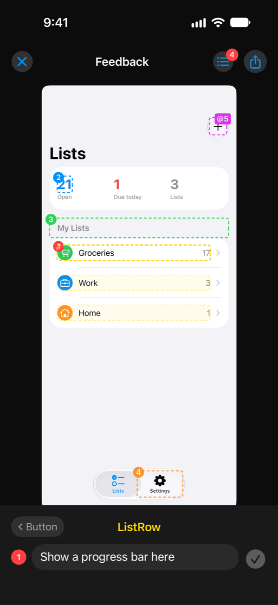
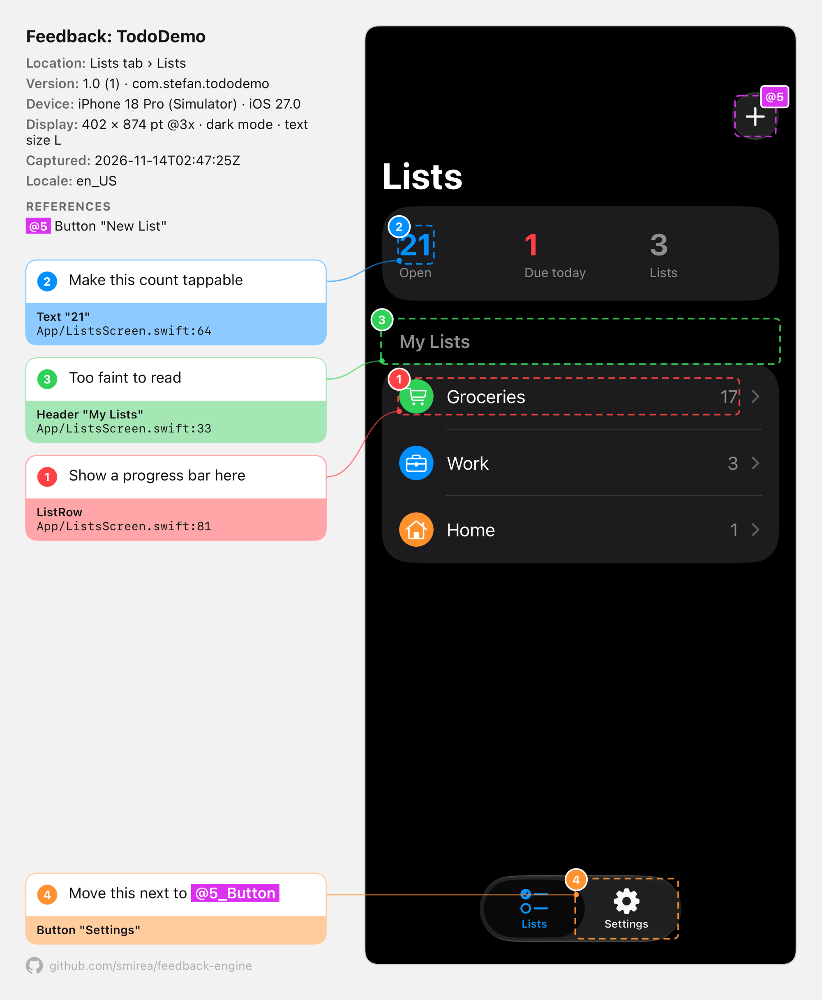
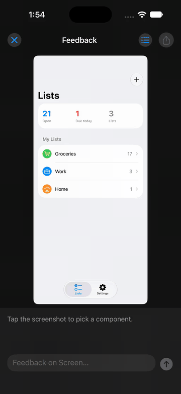

# Feedback

**Point at your app. Say what's wrong. Hand an agent the exact component and line of code.**

Shake the device, or press a shortcut in the browser, tap any component on the frozen screenshot, and write what should change. Feedback exports one file that names every component you flagged, where it lives in the source, and the data it was showing, so an agent can act on the feedback without guessing.

<p align="center">
  
  &nbsp;&nbsp;&nbsp;
  
</p>

<p align="center"><sub>Left: tap a component in the editor. Right: the <code>feedback.png</code> it exports, ready to paste into a chat with an agent.</sub></p>

<p align="center">
  <br>
  <sub>Three notes and the exported image in about 10 seconds. <a href="docs/demo.mp4">Full quality video</a></sub>
</p>

Prefer structured data? Share JSON for the whole component tree, each component's data, and the app context you attached, or both in one ZIP. Or post the feedback straight to a ProcrastiMate project as a task.

Platform packages live under `packages/`: `Feedback` for iOS and `@smirea/feedback-engine` for the web, with Svelte as its first entry point. Both produce the same report ([spec/report.md](spec/report.md)). [spec/features.md](spec/features.md) lists every feature with its status on each platform.

## iOS

Requires iOS 17 or later and Swift 6.

### Add the package

In Xcode, add the package from this repository (or a local checkout with **Add Local…**) and link the `Feedback` library to your app target. In a `Package.swift`:

```swift
.package(url: "https://github.com/smirea/feedback-engine", branch: "master"),
```

### Turn it on

```swift
import Feedback

@main
struct MyApp: App {
    @State private var store: Store

    init() {
        let store = Store()
        _store = State(initialValue: store)
        Feedback.enable()
        Feedback.context("Store") { store }
    }
    // ...
}
```

- `Feedback.enable()` turns on shake-to-feedback. A shake morphs an **Add Feedback** glass pill out of the top center of the screen, growing from a Dynamic Island–sized capsule, and tapping it opens the editor. Top center sits between a navigation bar's leading and trailing buttons, so the pill covers at most the bar's title. Left alone, the pill morphs back up after 5 seconds, so an accidental shake costs nothing. Leaving the app or locking the phone clears it at once. Wrap the call in `#if DEBUG` if you only want it in development builds.
- `Feedback.context(name) { value }` attaches app state to every JSON export. The closure runs when a capture is taken.
- `Feedback.present()` opens the editor directly from your own trigger, such as a settings button.
- **ProcrastiMate** in the Share menu posts with the session ProcrastiMate shares through the keychain group `FNYFHG5SV7.com.stefan.shared` while it is signed in on the device. Add `$(AppIdentifierPrefix)com.stefan.shared` to the app's `keychain-access-groups` entitlement. A simulator build has to be signed, even ad hoc (`CODE_SIGN_IDENTITY=-`), for the group to count. Without the entitlement, the picker says so.

### Name your components

Add one modifier at the end of each view's `body`:

```swift
struct TodoRow: View {
    let item: TodoItem
    @State private var isExpanded = false

    var body: some View {
        HStack { /* ... */ }
            .feedback(self)
    }
}
```

`.feedback(self)` names the component after its type, without generic arguments, so `DashboardCard<ProgressView<…>>` is `DashboardCard`. It reports the view's stored properties and its `@State`, `@Binding`, and `@Bindable` values. Closures, `@Environment` values, and other SwiftUI and Combine internals are skipped at any depth, including inside your own helper structs. To choose the name or the data yourself, use `.feedback("TodoRow", data: item)`.

Data reads like code: optionals show their value or `nil`, floating-point numbers keep 3 decimals (3 significant digits below 1), and nested values are written as `Entry(kg: 72.575, note: nil)`. Nesting stops after 3 levels and collections after 10 elements, and a component's data stops at 1,500 characters. Types with a `CustomStringConvertible` description, such as `Date` and `UUID`, use it.

Your own property wrappers are skipped unless they conform to `FeedbackRepresentable`, which reports `feedbackValue` in the wrapper's place. Conform any other type the same way to choose how it reads:

```swift
extension Observe: FeedbackRepresentable {
    var feedbackValue: Any { wrappedValue }
}
```

Untagged views still appear: buttons, text, images, and headers come from the accessibility tree and attach to the smallest tagged component around them. When two tagged views share a frame, such as a card that wraps another tagged view, they attach to the inner one. A button or `NavigationLink` merges everything inside it into one element, such as `Button "Work, 3"`, so the text and counts inside it can't be picked one by one. A tagged component inside the button still can, and its parent is the button. Tag an inner view when it needs feedback of its own.

### Set up your app's coding agents

[`skills/feedback-accessibility/SKILL.md`](skills/feedback-accessibility/SKILL.md) is the playbook for making screens accessible and precise to point at: built-in accessibility first, Feedback tags only where a tap would otherwise be ambiguous, and a way to check each screen. To have your app's agents follow it, add this to the app's `AGENTS.md` (or `CLAUDE.md`):

```md
- When you build or change a SwiftUI screen, row, card, or chart, follow Feedback's accessibility skill. Read the latest with `gh api repos/smirea/feedback-engine/contents/skills/feedback-accessibility/SKILL.md -H 'Accept: application/vnd.github.raw'`.
```

The command reads the skill from `master`, so the app picks up changes without a copy to update. To make it a project skill that Claude Code loads by name, copy the folder to `.claude/skills/feedback-accessibility/` instead, and refresh the copy when the skill changes.

### Give feedback

1. Shake the device, then tap **Add Feedback** at the top of the screen within 5 seconds. In the simulator, use **Device › Shake**.
2. Tap the screenshot. The most specific component or element under your finger is selected, and the same part in sibling components, such as the same button in every row, is outlined faintly. Scroll the screenshot to reach content that was off screen, and pinch to zoom in on small targets, up to 4×. Scrolling and zooming also work while you type.
3. Under the screenshot, the selection sits between its parent on the left and its child on the right. Tap either one to move the selection up or down the hierarchy.
4. Type the feedback and press the arrow. Repeat for as many items as you need.
   To point at another element in the text, type `@`. While the `@` is the last thing you typed, a tap on the screenshot picks the element to reference instead of moving the selection, and the faint outlines of similar parts hide. The picked element shows in cyan above the field, with up and down arrows to move to its parent or child. **Insert** replaces the `@` with a token such as `@1_Dialog`. The element keeps that number for the whole capture, so referencing it again inserts the same token, and its box gets an `@1` tag in its corner. Typing anything else instead leaves reference mode.
5. Tap inside a numbered box to bring back that item's feedback and edit it, then press the checkmark to save. Tap the same spot again, or step to the child, to give feedback on something inside the box instead. Feedback belongs to one level: stepping to the parent or child shows theirs, or a blank field for a new item.
6. Open the list to review or remove items, and to see the context that will be attached.
7. Tap **Share** and pick what to send. **Image** is one `feedback.png` with the boxes, each item's text and code location with its references highlighted in their colors, and the environment. **JSON** is one `feedback.json` with every item, the whole component tree, the component data, and the attached context, without the screenshot. **Image and JSON (ZIP)** is both files in one `feedback.zip`. In the share sheet, **Copy Feedback** puts the export on the clipboard, ready to paste into a chat with an agent, and other targets, such as Messages, Notes, or Files, receive it too.
8. **ProcrastiMate** opens a project picker with the last project you posted to already selected. A project with sections lists them under it once picked. The task name starts as the screen's navigation title, `Feedback`, and the number of items, such as `Groceries Feedback: 3 changes`. On a device with Apple Intelligence, the on-device model then summarizes the items in the background, with a spinner beside the name, and the name becomes `3 Groceries Feedback: bigger titles, remove the share button`. A name you have typed by then stays. You can edit it either way, and **Add** never waits for the summary. **Add** creates the task with the image and `feedback.json` attached, and a toast confirms it. Tap the toast to open the task in ProcrastiMate.
9. Tap **Close** to return to the app. If some items were never shared, Feedback asks before it discards them. The text field that had focus before the editor opened gets it back.

While the editor is open, VoiceOver and UI automation see only the editor. Its text stops growing at the largest standard Dynamic Type size, so the screenshot keeps room at accessibility sizes.

### How capture works

- The screenshot and the tagged components are read at the moment you tap the feedback button. Each `.feedback` modifier places a plain `UIView` behind its view, and a capture walks the view hierarchy to find them. Tagging costs nothing per frame.
- Component nesting follows the SwiftUI hierarchy, so parents in the export are the real logical parents.
- When the screen has a scrolling list or scroll view that covers at least half of it, the capture covers that content at full length. Feedback covers the app with the frozen screenshot, scrolls through the content one screen at a time, reads each step, and then restores the scroll position. The editor opens at the part that was on screen.
- A sheet expanded to full height is captured the same way when its own list or scroll view covers at least half the screen. The sheet grows with its content, and the screen behind it stays as it was. A sheet at a smaller detent floats over the screen, so it is captured as it looks.
- SwiftUI only exposes accessibility elements while an assistive client is running. During a capture Feedback turns on accessibility automation, which is the same private switch XCTest and Cash App's AccessibilitySnapshot use, and then restores it. The first capture in a process pauses for about a second while UIKit loads its accessibility support. Later captures take a few milliseconds.
- Presented sheets, alerts, and open menus are separate layers. Taps on a sheet only select what is inside the sheet, and the items of an open menu can be picked one by one. Whatever a sheet or cover hides completely is left out of the tree, so a full-screen cover exports only its own content.
- The keyboard is drawn by a system process, so a capture can't contain it. Feedback draws a gray "Keyboard" block in its place, so the bars above it stay where they were, and taps there select the keyboard instead of the content under it.

### Limits

- Only the largest vertical scroll view of the topmost screen or expanded sheet is captured at full length, and only when nothing floats over it, such as a menu, the keyboard, or an extra window for a toast. Other scroll views, such as horizontal carousels, show what was on screen.
- A full-length capture stops at 16,000 pixels, about 5,300 points on a 3x screen, and ends between two rows. A capture with a long list also takes longer, because each screen of content is read in turn.
- Scrolling during a capture is real scrolling. Code that reacts to it, such as infinite-scroll loading, runs.
- The accessibility switch is private API, looked up at runtime. If a future iOS removes it, captures still work with tagged components only. Be careful about shipping it in App Store builds.
- `.feedback(self)` reads `@Binding` values when a capture is taken. A binding whose getter can trap, such as `Binding(get: { selection! })`, crashes the capture the same way it would crash a redraw. Pass explicit `data:` for those views.
- Components inside lazy containers, such as `List` and `LazyVStack`, appear only for rows that exist on screen, except in the scroll view captured at full length.

## Web

Requires Svelte 5.29 or later and Vite. The package ships TypeScript and Svelte source, and your app's Vite compiles it.

### Add the package

```sh
bun add github:smirea/feedback-engine
```

### Turn it on

```svelte
<!-- src/routes/+layout.svelte -->
<script lang="ts">
	import { setupFeedbackEngine } from '@smirea/feedback-engine/svelte';
	import { store } from '../lib/store.svelte';

	const feedback = setupFeedbackEngine({ app: 'Todo', version: '1.0' });
	feedback.context('Store', () => store);
</script>
```

- `setupFeedbackEngine()` turns on the shortcut. `Alt+Shift+F` drops an **Add Feedback** pill in at the top center, and clicking it captures the page and opens the editor. Left alone, the pill leaves after 5 seconds, and it leaves at once when the tab goes to the background. Pass `shortcut: 'Ctrl+Shift+K'` for other keys, or `shortcut: false` for none. On a server the call returns an engine that does nothing, so a layout needs no guard.
- `feedback.context(name, () => value)` attaches app state to every JSON export. The function runs when a capture is taken.
- `feedback.present()` opens the editor directly from your own trigger, such as a settings button. A phone has no keyboard shortcut, so give it one.
- To keep Feedback out of production, call it behind `import.meta.env.DEV` with a dynamic import. The production bundle then has the tags and none of the editor.

  ```ts
  if (import.meta.env.DEV) {
  	void import('@smirea/feedback-engine/svelte').then(({ setupFeedbackEngine }) => setupFeedbackEngine());
  }
  ```

Add the plugin to your Vite config. JavaScript has no `#fileID` and `#line`, so the plugin writes each tag's `file:line` in at build time.

```ts
// vite.config.ts
import { feedbackEngine } from '@smirea/feedback-engine/vite';

export default defineConfig({
	plugins: [sveltekit({ preprocess: [feedbackEngine()] })],
});
```

In a plain Svelte project, pass `preprocess: [feedbackEngine()]` to `svelte()` from `@sveltejs/vite-plugin-svelte`.

### Name your components

Attach a tag to each component's root element:

```svelte
<script lang="ts">
	import { feedback } from '@smirea/feedback-engine/svelte';

	let { item }: { item: TodoItem } = $props();
	let isExpanded = $state(false);
</script>

<li {@attach feedback()}>…</li>
```

`feedback()` names the component after its file, so `TodoRow.svelte` is `TodoRow`, and a SvelteKit route file is named after its folders, so `routes/lists/[id]/+page.svelte` is `ListsIdPage`. It reports the component's props and its `$state` variables. To choose the name or the data yourself, use `{@attach feedback('TodoRow', () => item)}`. The data function runs when a capture is taken, never while rendering.

Data reads like code, with the limits of the iOS package: `{kg: 72.575, note: null}` for a plain object, `Entry(kg: 72.575, note: null)` for a class instance, 3 decimals, 3 levels, 10 elements, and 1,500 characters. Functions and DOM nodes are skipped at any depth. Give a class a `toFeedback()` method to choose how it reads.

Untagged content still appears. Buttons, links, fields, headings, images, and text come from the DOM with their ARIA role and accessible name, and each one attaches to the tagged component around it. A button or a link is one element, such as `Link "Work 3"`, so the text inside it can't be picked by itself. A tagged component inside it still can. In a development build every element also reports its own `file:line`, so feedback on an untagged button names that button's line.

### Give feedback

The editor works as on iOS, with these differences:

- Hover the screenshot to see what a click would select.
- Hold Ctrl and scroll, or pinch on a trackpad, to zoom up to 4×.
- Enter adds the feedback. Shift with Enter adds a line.
- **Share** lists **Image**, **JSON**, and **Image and JSON (ZIP)**. Each one then offers **Copy Feedback**, **Save File**, and, where the browser can share files, **Share…**. A browser takes one clipboard item per copy, so copying the ZIP export puts one item on the clipboard with the image and the JSON, and the place you paste into picks the one it reads.

### Post to ProcrastiMate

A page cannot call ProcrastiMate from another origin, and a token in the page would be public. The dev server forwards the calls and adds the token:

```ts
// vite.config.ts
import { feedbackEngine, feedbackProcrastimate } from '@smirea/feedback-engine/vite';

export default defineConfig({
	plugins: [
		feedbackProcrastimate({ token: process.env.PROCRASTIMATE_TOKEN }),
		sveltekit({ preprocess: [feedbackEngine()] }),
	],
});
```

```ts
setupFeedbackEngine({ procrastimate: { url: '/__feedback/procrastimate' } });
```

**ProcrastiMate** then shows in the Share menu, with the same picker and task as on iOS. The token is a ProcrastiMate API token. The proxy runs in `vite dev` and `vite preview`. A deployed static site has no proxy, so leave `procrastimate` out there.

### How capture works

- The browser gives a page no way to read its own pixels without a permission prompt, so Feedback draws the DOM again into a canvas with [modern-screenshot](https://github.com/qq15725/modern-screenshot). On the example app, a scrolled page differs from the browser's own screenshot in under 0.5% of pixels, and a page with an open dialog in about 1%.
- The whole document is drawn at its full scroll height in one pass. Nothing scrolls on screen. The window jumps to its origin and back inside one task, so a sticky bar is read where the document has it, and scroll listeners run.
- Content that stays put while the page scrolls, such as a `position: fixed` tab bar, is drawn where it was on screen, over the visible part of the capture.
- A modal `<dialog>`, an open popover, and an `aria-modal` dialog are separate layers. Clicks on a layer only select what is inside it, and whatever it hides completely is left out of the tree.
- Roles and names come from the DOM with [dom-accessibility-api](https://github.com/eps1lon/dom-accessibility-api). There is nothing to switch on first, and reading a screen takes a few milliseconds.

### Limits

- The screenshot is a re-draw, not the screen's pixels. Cross-origin images, `<canvas>`, `<video>`, and iframes can come out blank, and a field's placeholder is drawn in its text color. It is tested in Chromium and in Playwright's WebKit, not in Safari itself.
- A very tall page is drawn at a lower scale, so the capture fits a 16 megapixel canvas.
- A scroll container inside the page shows what was on screen in it.
- A minified production build shows a class's minified name in component data, such as `a(count: 2)`.
- Element locations for untagged content exist only in development builds. Tagged components keep theirs in every build.
- A shake does not trigger Feedback on phones, and the task name is not summarized by an on-device model. [spec/features.md](spec/features.md) lists both as planned.

### Drive it from a script

`setupFeedbackEngine()` also puts the engine on `globalThis.__feedbackEngine`. `__feedbackEngine.present()` opens the editor without the shortcut, and `__feedbackEngine.lastExport` holds the files of the last export as `{ name, blob }`, written when a Share menu entry is chosen. `packages/web/e2e/feedback.e2e.ts` does both with Playwright.

## Example apps

`examples/todo-ios` is a small todo app with lists, a list detail screen, an edit sheet, and settings. Every screen is tagged. Run it with:

```sh
cd examples/todo-ios
./scripts/run
```

`examples/todo-svelte` is the same app for the web, a SvelteKit SPA. Run it from the repository root with:

```sh
bun install
bun run dev
```

## Development

```sh
swift build   # compiles the package for macOS
swift test    # tree building, hit-testing, stitching, JSON export, and value description tests
```

```sh
bun run lint        # oxlint and oxfmt
bun run typecheck   # svelte-check for the example app and the web package, then the repository's TypeScript
bun test            # the web core, the Vite plugin, the shared fixture, and the checks on spec/features.md
bun run test:web    # the example app in Chromium and WebKit, on a dev server and a production build
```

`bun run test:web` needs Playwright's browsers once:

```sh
bunx playwright install chromium webkit
```
