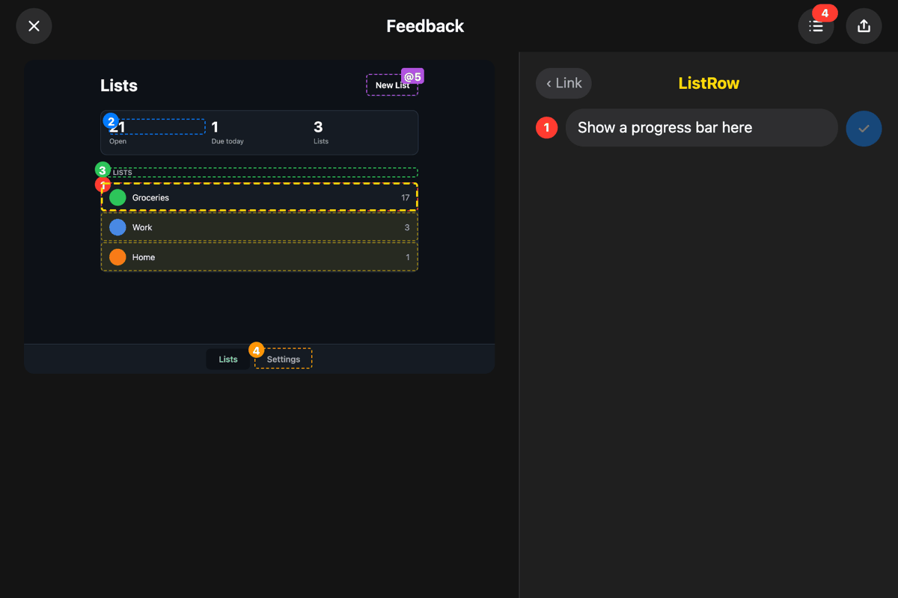

# @stefan.inc/feedback-engine

In-app feedback for Svelte and React apps. For SwiftUI, use the [iOS package](https://github.com/smirea/feedback-engine#ios) from the same repository.

**Point at your app. Say what's wrong. Hand an agent the exact component and line of code.**

Alt+Meta+click anything in the browser, click any component on the frozen screenshot, and write what should change. Feedback exports one file that names every component you flagged, where it lives in the source, and the data it was showing, so an agent can act on the feedback without guessing.

| The editor in the browser | The `feedback.png` it exports |
| :---: | :---: |
|  |  |

Four notes on the React example in Google Chrome. The last one points at a second element. Type `@`, click the element, and the note reads `Move this next to @5_Button`. The export draws that element's box and highlights the token in the same color, so an agent knows which button you meant. Each card names its component or element and the `file:line` it comes from, such as `src/components/ListRow.tsx:4`.

Prefer structured data? Share JSON for the whole component tree, each component's data, and the app context you attached, or both in one ZIP. A [webhook](#webhooks) adds a Share entry that posts both to a server of yours in one click, such as one that files a GitHub issue. [The report format](https://github.com/smirea/feedback-engine/blob/master/spec/report.md) is the same on every platform.

## Install

```sh
bun add @stefan.inc/feedback-engine
```

The package has one entry point per framework, `/svelte` and `/react`. A Svelte app builds with Vite. A React app builds with Vite or with [Next.js](#nextjs). The package ships TypeScript and Svelte source, and your app's bundler compiles it. The editor is the same in both: Svelte components in a shadow root. A React app needs no Svelte setup, because the package's Vite plugin or Next.js config compiles the editor.

## Svelte

Requires Svelte 5.29 or later.

### Turn it on

```svelte
<!-- src/routes/+layout.svelte -->
<script lang="ts">
	import { setupFeedbackEngine } from '@stefan.inc/feedback-engine/svelte';
	import { store } from '../lib/store.svelte';

	const feedback = setupFeedbackEngine({ app: 'Todo', version: '1.0' });
	feedback.context('Store', () => store);
</script>
```

- `setupFeedbackEngine()` turns on the trigger. Alt+Meta+click on anything, which is Option+Command+click on a Mac, captures the page and opens the editor with what you clicked selected. The app never gets that click, so a link does not navigate, and a disabled button can be clicked too. Pass `shortcut: 'Ctrl+Shift+Click'` for another chord, or `shortcut: false` for none. On a server the call returns an engine that does nothing, so a layout needs no guard.
- A chord that ends in a key, such as `shortcut: 'Alt+Shift+F'`, drops an **Add Feedback** pill in at the top center instead, and clicking the pill captures the page. Left alone, the pill leaves after 5 seconds, and it leaves at once when the tab goes to the background.
- `feedback.context(name, () => value)` attaches app state to every JSON export. The function runs when a capture is taken.
- `button: true` shows a round Feedback button in the bottom right corner of every screen, for a phone, which has no modifier keys, and for an app opened from the home screen. Tapping it captures the page. Drag it to move it up or down, or to the other side. It stays where you leave it.
- On a phone, hold three fingers still on the screen. A capsule grows at the top center while you hold, and after 0.7 seconds the page is captured and the editor opens. Lifting or sliding a finger cancels it, so pans and pinches stay the app's. Pass `threeFingerHold: false` to turn it off.
- `feedback.countdown()` is another trigger for a phone, where a shake does not work yet. Call it from an entry in one of your app's menus, such as Settings. The pill shows **Feedback in 5** and counts down, so you have 5 seconds to leave the menu and open the screen you mean. Then it captures. Tapping the pill captures at once, and `countdown(10)` gives more time.
- `feedback.present()` captures at once, with no countdown. It suits a control that is on the screen you want to capture.
- To keep Feedback out of production, call it behind `import.meta.env.DEV` with a dynamic import. The production bundle then has the tags and none of the editor.

  ```ts
  if (import.meta.env.DEV) {
  	void import('@stefan.inc/feedback-engine/svelte').then(({ setupFeedbackEngine }) => setupFeedbackEngine());
  }
  ```

Add the plugin to your Vite config. JavaScript has no `#fileID` and `#line`, so the plugin writes each tag's `file:line` in at build time.

```ts
// vite.config.ts
import { feedbackEngine } from '@stefan.inc/feedback-engine/vite';

export default defineConfig({
	plugins: [sveltekit({ preprocess: [feedbackEngine()] })],
});
```

In a plain Svelte project, pass `preprocess: [feedbackEngine()]` to `svelte()` from `@sveltejs/vite-plugin-svelte`.

### Name your components

Attach a tag to each component's root element:

```svelte
<script lang="ts">
	import { feedback } from '@stefan.inc/feedback-engine/svelte';

	let { item }: { item: TodoItem } = $props();
	let isExpanded = $state(false);
</script>

<li {@attach feedback()}>…</li>
```

`feedback()` names the component after its file, so `TodoRow.svelte` is `TodoRow`, and a SvelteKit route file is named after its folders, so `routes/lists/[id]/+page.svelte` is `ListsIdPage`. It reports the component's props and its `$state` variables. To choose the name or the data yourself, use `{@attach feedback('TodoRow', () => item)}`. The data function runs when a capture is taken, never while rendering.

## React

Requires React 18 or later and Vite 8 or later. It is tested with React 18.3 and React 19.

### Turn it on

Add the plugin to your Vite config, before the React plugin:

```ts
// vite.config.ts
import { feedbackEngineReact } from '@stefan.inc/feedback-engine/vite';
import react from '@vitejs/plugin-react';

export default defineConfig({
	plugins: [feedbackEngineReact(), react()],
});
```

```tsx
// src/main.tsx
import { setupFeedbackEngine } from '@stefan.inc/feedback-engine/react';
import { store } from './store';

const feedback = setupFeedbackEngine({ app: 'Todo', version: '1.0' });
feedback.context('Store', () => store);
```

`setupFeedbackEngine()` takes the options and returns the engine described under [Svelte](#turn-it-on). Call it before or after React renders. To keep Feedback out of production, call it behind `import.meta.env.DEV`. In a React 18 app with seven components, the production bundle then grew by 1.3 kB, for the component names, and had none of the editor.

The plugin does three things:

- It registers every component in your `.jsx` and `.tsx` files with its name and `file:line`. React knows a component only by its function's name, which a minified build replaces.
- It compiles the editor's Svelte files. Without the plugin, the build stops at the first one. Svelte is a peer dependency, which `bun add` and `npm install` add by themselves.
- On the dev server, it writes each HTML element's `file:line` into a `data-feedback-source` attribute, because React 19 no longer records it. `feedbackEngineReact({ elementSources: false })` turns that off, and test runs never get it. `elementSources: true` writes it into a production build too, for a deployed preview where people give feedback.

### Components need no tags

React keeps its component tree at runtime, so a capture reads it. Every component of your app is in the capture under its own name, with its props as its data and the `file:line` of its declaration:

```tsx
export function TodoRow({ item, onToggle }: { item: TodoItem; onToggle: () => void }) {
	return <li>…</li>;
}
```

A capture shows `TodoRow` with `item: {id: "…", title: "Oat milk", …}` at `src/components/TodoRow.tsx:3`.

- A component is found when it is declared at the top level of a module: a function, a class, an arrow function, or a `memo` or `forwardRef` call. A component declared inside another function is not.
- A library's components, such as a router's `Link`, stay out of the tree. The elements they draw still appear.
- `children` and functions are left out of the data, and a prop that is JSX reads as its tag, such as `<Icon>`.
- A component that renders several elements is one box around them. A component that draws through a portal sits where it draws.

### Tag a region, or add state

`feedback(name, data)` returns a ref. Use it for a region that is drawn inline, without a component of its own:

```tsx
import { feedback } from '@stefan.inc/feedback-engine/react';

<figure ref={feedback('Chart', () => plot)}>…</figure>;
```

React keeps hook state without names, so a capture cannot read it. To report state, tag the component's root element under the component's own name. The tag's data then replaces the props:

```tsx
export function TodoDetailDialog({ item }: { item: TodoItem }) {
	const [draft, setDraft] = useState({ ...item });
	return <dialog ref={feedback('TodoDetailDialog', () => ({ item: draft }))}>…</dialog>;
}
```

The data function runs when a capture is taken, never while rendering. On an element that already has a ref, call both from one ref function.

## Next.js

Requires Next.js 16 and React 19. Turbopack, the default, and webpack (`--webpack`) both work. Wrap your config:

```ts
// next.config.ts
import { withFeedbackEngine } from '@stefan.inc/feedback-engine/next';

export default withFeedbackEngine({
	// your config
});
```

`withFeedbackEngine()` does what the [React plugin](#react) does: it registers your components, compiles the editor, and writes each HTML element's `file:line` into `data-feedback-source` in `next dev`. It also adds the package to `transpilePackages`, and keeps your own `turbopack.rules` and `webpack` function.

Turn Feedback on from a client component in your root layout:

```tsx
// app/Feedback.tsx
'use client';

import { setupFeedbackEngine } from '@stefan.inc/feedback-engine/react';
import { useEffect } from 'react';

export function Feedback() {
	useEffect(() => setupFeedbackEngine({ app: 'My App', button: true }).destroy, []);
	return null;
}
```

```tsx
// app/layout.tsx
<body>
	{children}
	<Feedback />
</body>
```

- Client components are in the capture under their own names, as in a Vite app. A server component leaves no component in the page, so it is not a node. The elements it draws are, each with its own `file:line`.
- On a deployed preview, such as a Vercel preview link, pass `withFeedbackEngine(config, { elementSources: true })` so a production build keeps every element's `file:line`. Components keep theirs in every build without it. The attribute puts your file paths in the page's HTML, so leave it off a public production deploy, for example with `elementSources: process.env.VERCEL_ENV === 'preview'`.
- To keep Feedback off a production deploy, render `<Feedback />` only where you want it, for example behind `process.env.NEXT_PUBLIC_VERCEL_ENV !== 'production'`.
- `feedbackProcrastimate()` is a Vite plugin, so a Next.js app has no ProcrastiMate entry unless you pass `procrastimate: { url }` for a proxy of your own.

## Component data and untagged content

Data reads like code, with the limits of the iOS package: `{kg: 72.575, note: null}` for a plain object, `Entry(kg: 72.575, note: null)` for a class instance, 3 decimals, 3 levels, 10 elements, and 1,500 characters. Functions and DOM nodes are skipped at any depth. Give a class a `toFeedback()` method to choose how it reads.

Untagged content still appears. Buttons, links, fields, headings, images, and text come from the DOM with their ARIA role and accessible name, and each one attaches to the component around it. A button or a link is one element, such as `Link "Work 3"`, so the text inside it can't be picked by itself. A tagged component inside it still can. In a development build every element also reports its own `file:line`, so feedback on an untagged button names that button's line.

## Set up your app's coding agents

[`skills/feedback-accessibility/SKILL.md`](https://github.com/smirea/feedback-engine/blob/master/skills/feedback-accessibility/SKILL.md) is the playbook for making screens accessible and precise to point at, with a section for Svelte and one for React: the accessibility rules, what to tag, and how to check a screen. To have your app's agents follow it, add this to the app's `AGENTS.md` (or `CLAUDE.md`), with `React` in place of `Svelte` for a React app:

```md
- When you build or change a Svelte screen, row, card, or chart, follow Feedback's accessibility skill. Read the latest with `gh api repos/smirea/feedback-engine/contents/skills/feedback-accessibility/SKILL.md -H 'Accept: application/vnd.github.raw'`.
```

## Give feedback

The editor works as on iOS, with these differences:

- Hover the screenshot to see what a click would select.
- Hold Ctrl and scroll, or pinch on a trackpad, to zoom up to 4×.
- Enter adds the feedback. Shift with Enter adds a line.
- **Share** lists **Image**, **JSON**, and **Image and JSON (ZIP)**. Each one then offers **Copy Feedback**, **Save File**, and, where the browser can share files, **Share…**. A browser takes one clipboard item per copy, so copying the ZIP export puts one item on the clipboard with the image and the JSON, and the place you paste into picks the one it reads.

## Post to ProcrastiMate

Optional, and off until the dev server has a token. [ProcrastiMate](https://github.com/smirea/procrastimate) is the task app that Feedback's author files feedback into. A page cannot call ProcrastiMate from another origin, and a token in the page would be public, so the dev server forwards the calls and adds the token:

```ts
// vite.config.ts
import { feedbackProcrastimate } from '@stefan.inc/feedback-engine/vite';

export default defineConfig({
	plugins: [feedbackProcrastimate({ token: process.env.PROCRASTIMATE_TOKEN }) /* and the plugins above */],
});
```

The token is the switch. With `PROCRASTIMATE_TOKEN` set, **ProcrastiMate** shows in the Share menu, with the same picker and task as on iOS. Without it, the entry is not there, and nothing else changes. `setupFeedbackEngine()` needs no option for either case.

- The token is a ProcrastiMate API token. `feedbackProcrastimate({ url })` names another ProcrastiMate server.
- The proxy runs in `vite dev` and `vite preview`. A build reads the token too. Build a site you deploy without it, because a static host has no proxy.
- For a proxy of your own, pass its address to the page instead: `setupFeedbackEngine({ procrastimate: { url: '/my-proxy' } })`.

## How capture works

- The browser gives a page no way to read its own pixels without a permission prompt, so Feedback draws the DOM again into a canvas with [modern-screenshot](https://github.com/qq15725/modern-screenshot). On the example app, a scrolled page differs from the browser's own screenshot in under 0.5% of pixels, and a page with an open dialog in about 1%.
- The whole document is drawn at its full scroll height in one pass. Nothing scrolls on screen. The window jumps to its origin and back inside one task, so a sticky bar is read where the document has it, and scroll listeners run.
- Content that stays put while the page scrolls, such as a `position: fixed` tab bar, is drawn where it was on screen, over the visible part of the capture.
- A modal `<dialog>`, an open popover, and an `aria-modal` dialog are separate layers. Clicks on a layer only select what is inside it, and whatever it hides completely is left out of the tree.
- Roles and names come from the DOM with [dom-accessibility-api](https://github.com/eps1lon/dom-accessibility-api). There is nothing to switch on first, and reading a screen takes a few milliseconds.

## Limits

- The screenshot is a re-draw, not the screen's pixels. A `<canvas>`, an inline SVG, and an image from another origin that allows CORS are drawn. An image from an origin that does not allow CORS, a `<video>`, and an iframe can come out blank, and a field's placeholder is drawn in its text color. It is tested in Chromium, in Google Chrome, and in Playwright's WebKit, not in Safari itself.
- A very tall page is drawn at a lower scale, so the capture fits a 16 megapixel canvas.
- A scroll container inside the page shows what was on screen in it.
- A minified production build shows a class's minified name in component data, such as `a(count: 2)`.
- Element locations for untagged content exist only in development builds, unless a React app turns on `elementSources`. Components keep theirs in every build.
- React: a capture reads fields that are internal to React, the ones React's own developer tools read. If React renames them, components found without a tag are missing, and tagged regions and elements still appear. Bundlers other than Vite and Next.js are not supported.
- A shake does not trigger Feedback on phones, where a three-finger hold, `button: true`, or `countdown()` from a menu stands in for it, and the task name is not summarized by an on-device model. [spec/features.md](https://github.com/smirea/feedback-engine/blob/master/spec/features.md) lists both as planned.

## Drive it from a script

`setupFeedbackEngine()` also puts the engine on `globalThis.__feedbackEngine`. `__feedbackEngine.present()` opens the editor without the click, and `__feedbackEngine.lastExport` holds the files of the last export as `{ name, blob }`, written when a Share menu entry is chosen. `packages/web/e2e/feedback.e2e.ts` does both with Playwright, for the Svelte app and the React app.

## Webhooks

A webhook is a Share entry of your own. Choosing it posts the image export and the JSON export to your server in one request, with nothing to fill in, and a toast links to whatever the server made. List any number of them when you set Feedback up:

```ts
import { githubIcon, setupFeedbackEngine } from '@stefan.inc/feedback-engine/svelte'; // or '/react'

setupFeedbackEngine({
	webhooks: [{ name: 'GitHub Issue', url: 'https://hooks.example.com/feedback', image: githubIcon }],
});
```

Each webhook also takes `headers` and `query`, as fixed values or as a function that runs when the post is made, for a token the user only has once signed in. [docs/webhooks.md](https://github.com/smirea/feedback-engine/blob/master/docs/webhooks.md) has the request, the answer a server gives, and a server that files every post as a GitHub issue.

## Releases

Every change is a release, versioned by [semver](https://semver.org). [CHANGELOG.md](https://github.com/smirea/feedback-engine/blob/master/packages/web/CHANGELOG.md) lists them. A major version is only for a change that breaks an app that upgrades without editing its code.

## License

MIT
